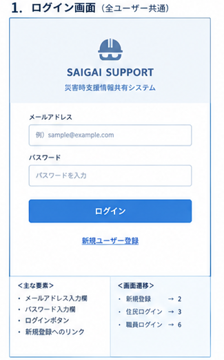
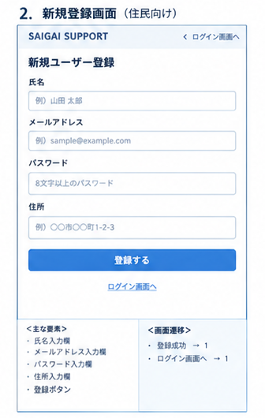
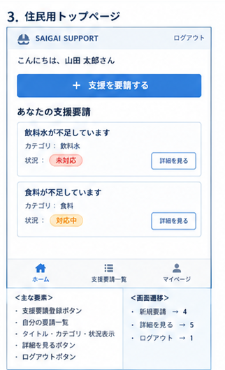
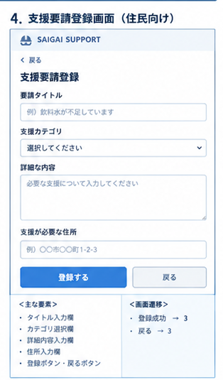
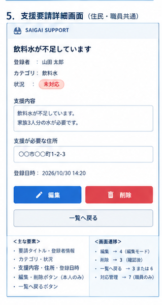
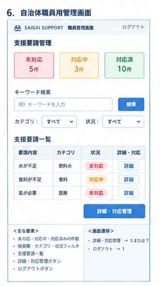
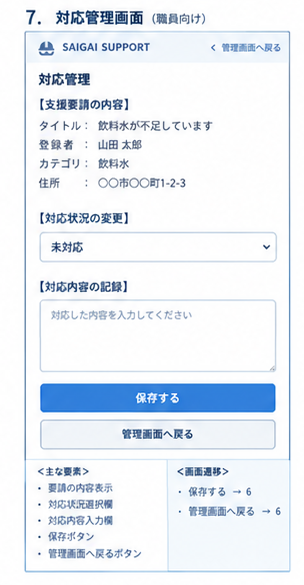
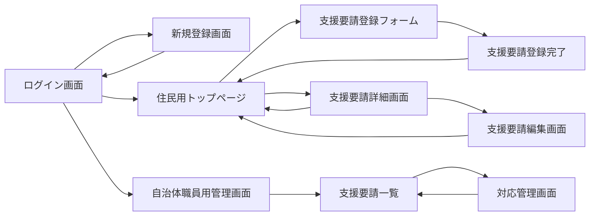
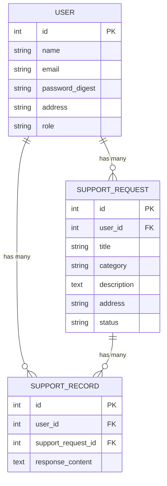

# 基本設計書：災害時支援情報共有システム

- チーム番号：チーム09
- メンバー：松岡祐史、鶴田涼太

## 課題
- **選んだ課題**：災害時に在宅避難者が必要としている支援を把握できず、必要な物資や支援を届けることが難しい。、
- **誰の課題か**：在宅避難者, 自治体職員
- **なぜこの課題を選んだか**：災害が発生した際、避難所にいる人だけでなく、自宅で避難生活を送る人にも支援が必要になる。しかし、在宅避難者が何を必要としているのかを把握することは難しいと考えた。

そこで、住民が必要な支援を登録し、自治体職員がその情報を一元管理できるシステムを作ることで、支援の必要な人を把握しやすくしたいと考えた。
- **（方法Bで選んだ場合のみ）元になった自治体課題**：COG2026 千葉県流山市

「災害時、在宅避難者の『困った』をどう把握し、支援につなげるか」

## 0. 考えを整理する3つの問い
- **開発目的**：災害時に在宅避難者が必要としている物資や支援を把握できないという問題を解決するため、住民が支援要請を登録し、自治体職員が対応状況を管理・共有できるシステムを開発する。
- **想定ユーザ**：在宅避難者（支援を必要としている住民）

自治体職員（支援要請を管理する担当者）
- **機能**：ユーザー登録・ログイン機能
支援要請の登録機能
支援要請の一覧表示機能
支援要請の詳細表示機能
支援要請の編集・削除機能
支援要請の検索・絞り込み機能
支援要請の対応状況管理機能
対応記録の登録機能

## 1. ユーザーストーリー
- ストーリー1：【在宅避難者】として、自分が必要としている支援を自治体に伝えるため、スマートフォンから必要な物資や支援内容を登録したい。
- ストーリー2：【在宅避難者】として、自分の支援要請が現在どのような状況なのかを把握するため、登録した要請の対応状況を確認したい。
- ストーリー3：【自治体職員】として、支援が必要な住民を把握するため、登録された支援要請を一覧で確認し、未対応の要請を検索したい。
- ストーリー4：【自治体職員】として、どのような支援を実施したのかを記録するため、各支援要請に対応内容を登録したい。

## 2. 画面イメージ（ワイヤーフレーム）
手書き・PowerPoint・Figma・Excalidrawなどで作った画面ラフを、画像として貼る。

> ここは実際に手を動かして描いた画像に差し替えてください。きれいである必要はなく、「どこに何があるか」「押したらどこへ行くか」が伝わればOKです。

## 3. ページ遷移図

## 4. データモデル（ER図）

- 関連は1（User）：多（SupportRequest）。外部キー user_id を持つ＝参照元はSupportRequest側。
- `User has_many :support_requests` / `SupportRequest belongs_to :user`
- 関連は1（User）：多（SupportRequest）。外部キー user_id を持つ＝参照元はSupportRecord側。
- `User has_many :support_records` / `SupportRecord belongs_to :user`
- 関連は1（SupportRequest）：多（SupportRecord）。外部キー support_request_id を持つ＝参照元はSupportRecord側。
- `SupportRequest has_many :support_records` / `SupportRecord belongs_to :support_request`

## 5. 開発着手の許可基準に対する自己チェック
- [ ] 課題の具体性：身近な実在のペインに基づいているか？
- [ ] 連動性：ユーザーストーリーと画面・データモデルが破綻なく繋がっているか？
- [ ] ボリュームの妥当性：第14回までに2名で作りきれる規模感か？